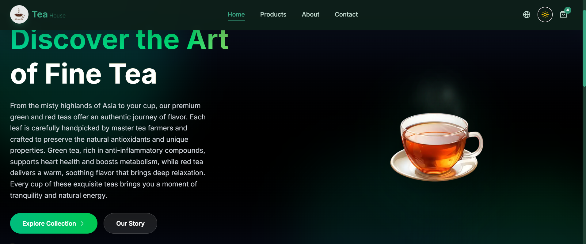

# 🍵 TeaShop

> A modern, full-stack e-commerce platform for premium tea lovers — built with Next.js App Router, TypeScript, and Tailwind CSS.



---

## 📖 Table of Contents

- [About the Project](#-about-the-project)
- [Features](#-features)
- [Tech Stack](#-tech-stack)
- [Screenshots](#-screenshots)
- [Getting Started](#-getting-started)
- [Project Structure](#-project-structure)
- [Environment Variables](#-environment-variables)
- [Available Scripts](#-available-scripts)
- [Roadmap](#-roadmap)
- [Contributing](#-contributing)
- [License](#-license)
- [Contact](#-contact)

---

## 🌿 About the Project

**TeaShop** is a modern e-commerce web application designed for buying and selling premium teas. It provides a seamless shopping experience with a clean, responsive interface, dynamic product browsing, and a persistent shopping cart.

The project is built with the **Next.js App Router**, leveraging **Server Components** for performance and **Client Components** for interactivity. It supports **internationalization (i18n)** with English and Persian locales, and uses **MongoDB** for product data storage.

Whether you're a tea enthusiast looking for your next favorite blend or a developer exploring modern full-stack patterns, TeaShop is a practical, production-oriented example.

---

## ✨ Features

- 🛒 **Dynamic Shopping Cart** — Add, remove, and update quantities with persistent state via `localStorage`
- 🔍 **Product Search & Filtering** — Browse by category, search by name, and view detailed product pages
- 📱 **Fully Responsive Design** — Mobile-first layout that works on every screen size
- ⚡ **Blazing Fast Performance** — Powered by Next.js App Router and Server Components
- 🎨 **Clean & Modern UI** — Built with Tailwind CSS and a reusable component system
- 🌐 **Bilingual Support (i18n)** — English and Persian (RTL) locales
- 💾 **Persistent Cart** — Cart state survives page reloads
- 🏷️ **Category-Based Browsing** — Organized product catalog
- 🔐 **Authentication Ready** — Login and registration routes scaffolded
- 🗄️ **MongoDB Integration** — Product and user models with Mongoose

---

## 🛠 Tech Stack

| Category | Technology |
|---|---|
| **Framework** | [Next.js 16](https://nextjs.org/) (App Router, Turbopack) |
| **Language** | [TypeScript](https://www.typescriptlang.org/) |
| **Styling** | [Tailwind CSS](https://tailwindcss.com/) |
| **State Management** | React Context API + custom hooks |
| **Database** | [MongoDB](https://www.mongodb.com/) + [Mongoose](https://mongoosejs.com/) |
| **Validation** | [Zod](https://zod.dev/) |
| **i18n** | Custom lightweight i18n with JSON locales |
| **Icons & Assets** | SVG + optimized images via `next/image` |
| **Linting** | ESLint |
| **Package Manager** | npm |

---

## 📸 Screenshots

> Replace these placeholders with your actual screenshots.  
> Place image files inside `public/images/` and update the paths below.

### 🏠 Home Page


### 🛍️ Products Page


### 🧾 Product Details


### 🛒 Shopping Cart


### 🌙 Mobile View


---

## 🚀 Getting Started

### Prerequisites

Make sure you have the following installed:

- **Node.js** `18.17.0` or higher
- **npm** (or `yarn`, `pnpm`, `bun`)
- **MongoDB** (local instance or [MongoDB Atlas](https://www.mongodb.com/atlas) connection string)

### Installation

1. **Clone the repository**
   ```bash
   git clone https://github.com/your-username/tea-shop.git
   cd tea-shop

2. Project Structure


tea-shop/
├── public/
│   └── images/                  # Static images (logo, products, screenshots)
├── src/
│   ├── app/                     # Next.js App Router
│   │   ├── (auth)/              # Auth route group
│   │   │   ├── login/
│   │   │   └── register/
│   │   ├── about/               # About page
│   │   ├── api/                 # API routes
│   │   │   ├── auth/
│   │   │   ├── orders/
│   │   │   └── products/        # Product CRUD endpoints
│   │   ├── cart/                # Cart page
│   │   ├── contact/             # Contact page
│   │   ├── products/            # Product listing & details
│   │   │   └── [id]/            # Dynamic product route
│   │   ├── layout.tsx           # Root layout
│   │   ├── page.tsx             # Home page
│   │   └── globals.css          # Global styles
│   ├── components/
│   │   ├── features/            # Feature-specific components
│   │   │   ├── About/
│   │   │   ├── Hero/
│   │   │   └── Products/
│   │   ├── layout/              # Layout components (Header, Footer)
│   │   └── ui/                  # Reusable UI primitives (Button, etc.)
│   ├── constants/               # App-wide constants
│   ├── contexts/                # React Context providers
│   │   ├── AppContext.tsx
│   │   └── CartContext.tsx
│   ├── data/                    # Static/seed data
│   ├── hooks/                   # Custom React hooks
│   ├── i18n/                    # Internationalization
│   │   └── locales/             # en.json, fa.json
│   ├── lib/                     # Utilities & DB connection
│   │   ├── mongodb.ts
│   │   ├── utils.ts
│   │   └── models/              # Mongoose models
│   ├── models/                  # Shared domain models
│   ├── services/                # Business logic / API clients
│   ├── types/                   # TypeScript type definitions
│   └── utils/                   # Helper functions
├── .env.local                   # Environment variables (not committed)
├── next.config.ts               # Next.js configuration
├── tailwind.config.ts           # Tailwind configuration
├── tsconfig.json                # TypeScript configuration
├── package.json
└── README.md


## 📬 Contact

<p align="center">
  <a href="https://github.com/YALDAKHOSHPEY">
    
  </a>
  <a href="mailto:missyaldatw@example.com">
    
  </a>
</p>

<p align="center">
  <sub>Feel free to reach out for collaboration, questions, or just to say hi 🍵</sub>
</p>